<div align="center">

# 🕌 Namaz Vakitleri

**Namaz vakitleri, kıble, kaza takibi, hatim dağıtma ve internetsiz okunabilen bir kitaplık:<br>
telefona kurulan, hesap istemeyen, kişisel veri toplamayan bir web uygulaması (PWA).**

FastAPI · SQLite · Vanilla JS · Service Worker · IndexedDB · Docker

### 🌐 Canlı: **[namaz.sporyazilimlari.com.tr](https://namaz.sporyazilimlari.com.tr)**

**Bu yazılım tamamen açık kaynak kodludur.** Sunucu ve uygulamanın bütün kodu bu depodadır; inceleyebilir,
kendi sunucunuza kurabilir, geliştirmelere katkıda bulunabilirsiniz.
Kaynak kodu: **[github.com/purkusur-pixel/pray](https://github.com/purkusur-pixel/pray)**

Telefonda açıp “Yükle” (Android) ya da Paylaş › “Ana Ekrana Ekle” (iPhone) ile uygulama olarak kurabilirsiniz.

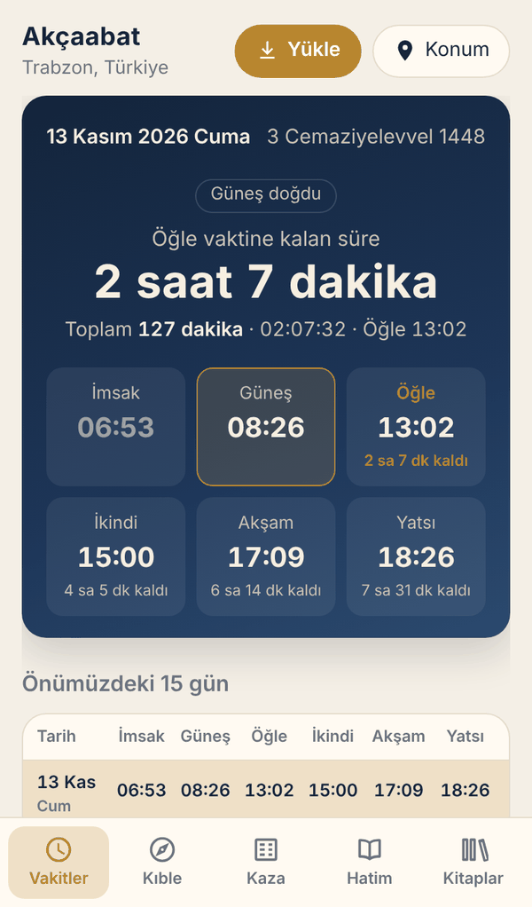 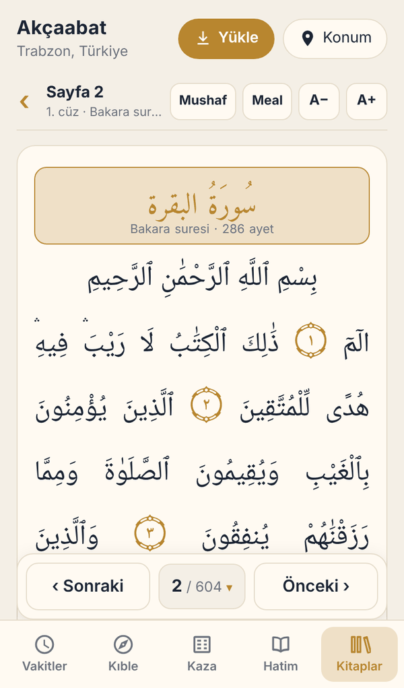 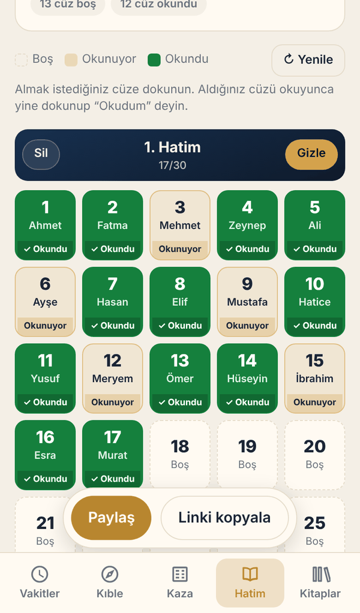

</div>

---

## İçindekiler

- [Özellikler](#özellikler)
- [Ekran görüntüleri](#ekran-görüntüleri)
- [Nasıl çalışır?](#nasıl-çalışır)
- [Veri kaynakları ve lisanslar](#veri-kaynakları-ve-lisanslar)
- [Gizlilik](#gizlilik)
- [Kurulum](#kurulum)
- [API](#api)
- [Proje yapısı](#proje-yapısı)

---

## Özellikler

### 🕐 Vakitler
- Diyanet'in yayımladığı vakitler; **her zaman 15 gün** listelenir.
- Sonraki vakte kalan süre açık yazıyla gösterilir: *“Öğle vaktine kalan süre — 2 saat 7 dakika”*. Her vakit kartında ayrıca “4 sa 5 dk kaldı” yazar.
- Miladî ve Hicrî tarih birlikte görünür.
- **Konum:** “Bulunduğum yeri bul” ile en yakın ilçe seçilir. İsteğe bağlı otomatik takip, başka ilçeye geçilince vakitleri kendiliğinden değiştirir.
- Yurt dışındaki ilçeler de seçilebilir (ülke › il › ilçe; ≈5.900 koordinatlı ilçe).
- **İnternetsiz çalışır:** Telefon ≈30 günlük veriyi saklar ve yılda yalnızca ≈26 küçük istek yapar.
- **Ana ekrana kurulur:** “Yükle” düğmesi Android'de yükleme penceresini açar, iPhone'da “Ana Ekrana Ekle” adımlarını gösterir.
- **Güncelleme:** Yeni sürüm arka planda iner, “Yeni sürüm hazır – Yenile” uyarısı çıkar.

### 🧭 Kıble
- Kıble açısı gerçek kuzeye göre hesaplanır; Kâbe'ye uzaklık da gösterilir.
- Manyetik sapma WMM2025 modeliyle eklenir. Uygulama, telefonun Pusula uygulamasında hangi dereceye bakılacağını da yazar.
- **Pusula modu:** Kıbleye dönünce kadran yeşile döner ve telefon titrer; değilse “26° sağa dönün” diye yönlendirir. Pusula kalibre değilse uyarır.
- GPS ile hassas konum alınabilir. Konum kaydedilmez.

### 🎙️ Sesli asistan: “Hey Siri, Namaz” / “Hey Google”
- **iPhone:** Kestirme, telefona özel bir adresten kalan süreyi alır ve Siri okur: *“Akçaabat. Öğle vaktine 45 dakika kaldı. Öğle saat 12:10.”*
- **Android:** “Hey Google, Namaz'ı aç” deyince uygulama açılır ve kalan süreyi telefonun kendi sesiyle söyler. Ek uygulama gerekmez.
- Uygulama içinde **Türkçe/İngilizce, görselli adım adım kılavuz** var.
- Cevap dili telefonun dilinden bağımsız seçilir.

### 📿 Kaza takibi
- Yedi kalem: sabah, öğle, ikindi, akşam, yatsı, vitir ve oruç. Her biri ayrı ayrı artırılıp azaltılır.
- **Hesapla:** Yıl/ay/gün ya da tarih aralığından borç hesaplanır. Özel hâl günleri düşülebilir. Sonuç mevcut değerlere eklenir ya da onların yerine yazılır.
- Diğer araçlar:
  - **Geri al:** son 50 değişiklik geri alınabilir.
  - **Ne zaman biter?** Günde kaç kaza kılındığına göre tahmini bitiş tarihini verir.
  - **Yedek kodu:** Telefon değiştirirken kayıtları taşımaya yarar.
- **Veriler yalnızca telefonda** tutulur; sunucuya hiçbir şey gitmez.

### 📖 Hatim dağıtma
- Bir link oluşturulur (`/h/AbC123xYz9`) ve WhatsApp ya da paylaşma menüsüyle gönderilir.
- **Cüz almak:** Linke dokunan kişi boş bir cüze adını yazıp “Okuyacağım” ya da “Okudum” der. Hatim, açtığı herkesin “Hatimlerim” listesinde kalır.
- **Hatmin sahibi şunları yapabilir:**
  - hatmi tamamlandı işaretlemek,
  - aynı linkte yeni hatim açmak,
  - linki değiştirmek (cüzler korunur),
  - yönetici linkiyle başka telefondan yönetmek.
- **Otomatik yeni hatim:** 30 cüz dağıtılınca sıradaki hatim kendiliğinden açılır.
- Değişiklik yoksa sunucu gövdesiz `304` döner.
- Sunucuda link başına **tek satır** tutulur (≈0,3–3 KB).

### 📚 Kitaplık (internetsiz okunur)

| Kitap | Ayrıntı |
|---|---|
| **Kur'an-ı Kerîm** | 604 sayfa, Medine Mushafı düzeni. Okudukça **cüz cüz iner** (≈50 KB/cüz). Ayrıca:<br>• iki yazı tipi: Medine Mushafı hattı ya da daha kolay okunan “bilgisayar baskısı”; bilgisayar baskısında **Türkiye mushaflarındaki yazım** (her sakin harfte cezm, idğam şeddesi ve vasl işareti yok)<br>• **durak (vakıf) işaretleri**<br>• **sayfaya, sureye ya da cüze git**<br>• parmakla sayfa çevirme, kaldığın yerden devam |
| **Meal ve tefsir** | Ayet ayet görünüm. Elmalılı Hamdi Yazır meali ve Muhtasar Tefsir. **70'ten fazla dilde meal** de indirilebilir: İngilizce, Almanca, Urduca, Boşnakça… |
| **Kur'an'da arama** | Türkçe yazınca mealde, Arapça yazınca Kur'an metninde arar. Hareke ve ş/s, ı/i farkı gözetilmez. Bulunan ayete gidilir ve ayet vurgulanır. |
| **Dua Kitabı** | 794 dua, 15 bölüm, **17 konu**: kayıp eşya, şifa, borç, yolculuk, sıkıntı… Her dua Arapça, okunuş ve anlamıyla verilir; kaynağına göre renklidir: <span>🟢 âyet · 🔵 hadis · 🟡 dua</span>. |
| **Esmâü'l-Hüsnâ** | 99 isim: Arapça yazılışı, okunuşu, kısa anlamı. İçinde arama yapılabilir. |
| **Hadis Kitapları** | Kütüb-i Sitte: Buhârî, Müslim, Ebû Dâvûd, Tirmizî, Nesâî, İbn Mâce. Her kitap bir kez iner. İçindekiler, sayfaya ve hadis numarasına git, isteğe bağlı Arapça metin. |
| **PDF kitaplarınız** | Telefondaki PDF eklenir ve telefonda saklanır. **İki parmakla yakınlaştırma**, çift dokunuşla büyütme; tablolar ve sütunlar bozulmaz. |

---

## Ekran görüntüleri

<table>
<tr>
<td align="center"><br><sub><b>Vakitler</b> · kalan süre, 15 gün</sub></td>
<td align="center">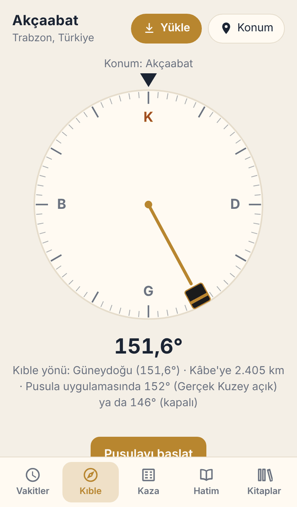<br><sub><b>Kıble</b> · pusula ve açı</sub></td>
<td align="center">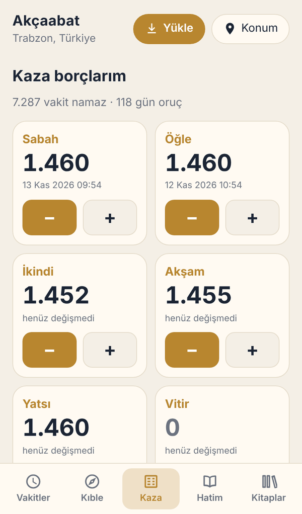<br><sub><b>Kaza</b> · bağımsız sayaçlar</sub></td>
</tr>
<tr>
<td align="center"><br><sub><b>Hatim</b> · link ile cüz dağıtma</sub></td>
<td align="center">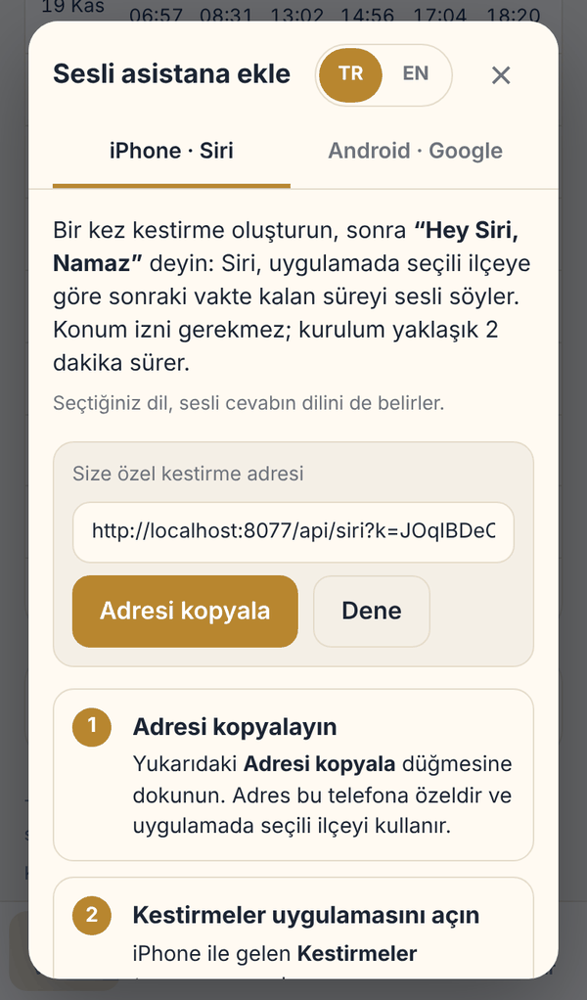<br><sub><b>Siri / Google</b> · TR/EN kılavuz</sub></td>
<td align="center">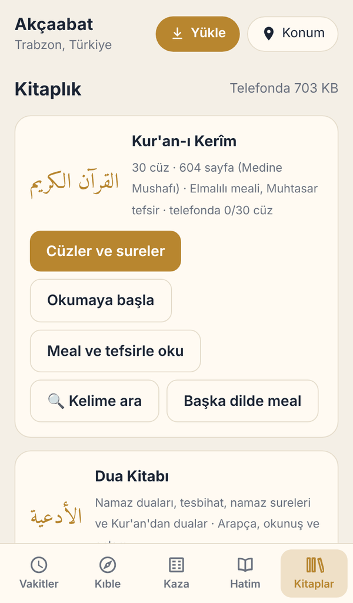<br><sub><b>Kitaplık</b></sub></td>
</tr>
<tr>
<td align="center"><br><sub><b>Mushaf</b> · Medine düzeni</sub></td>
<td align="center">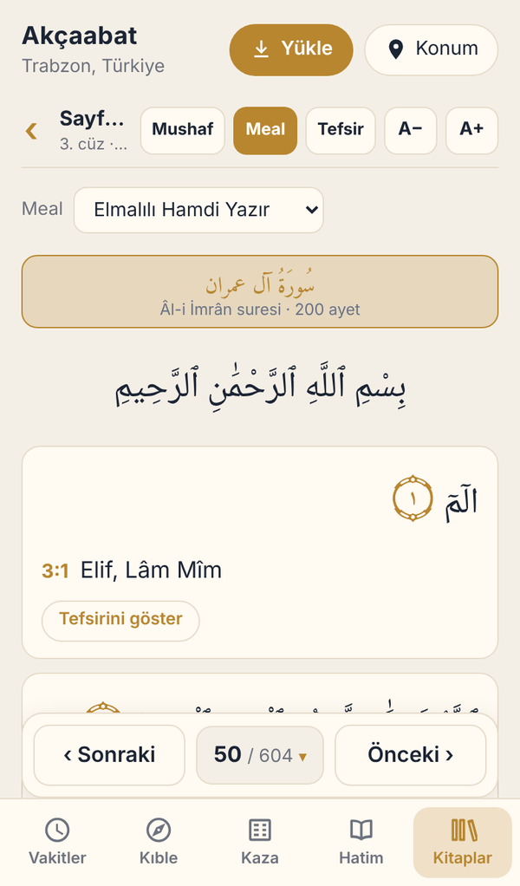<br><sub><b>Meal ve tefsir</b> · ayet ayet</sub></td>
<td align="center">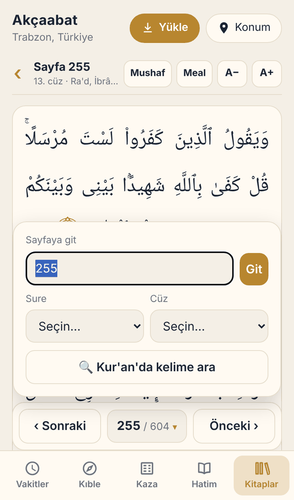<br><sub><b>Sayfaya git</b> · sayfa, sure, cüz</sub></td>
</tr>
<tr>
<td align="center">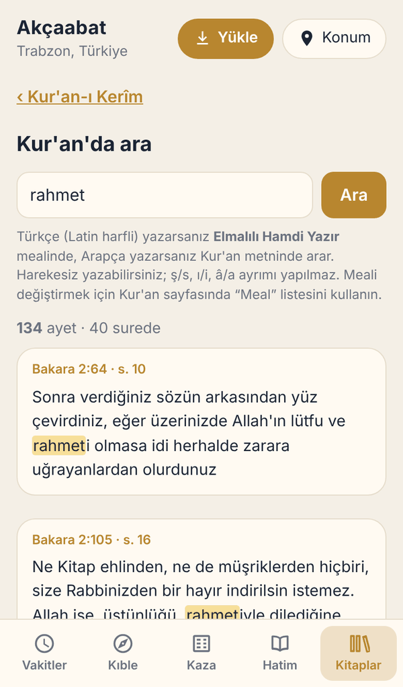<br><sub><b>Kelime arama</b> · meal ya da Arapça</sub></td>
<td align="center">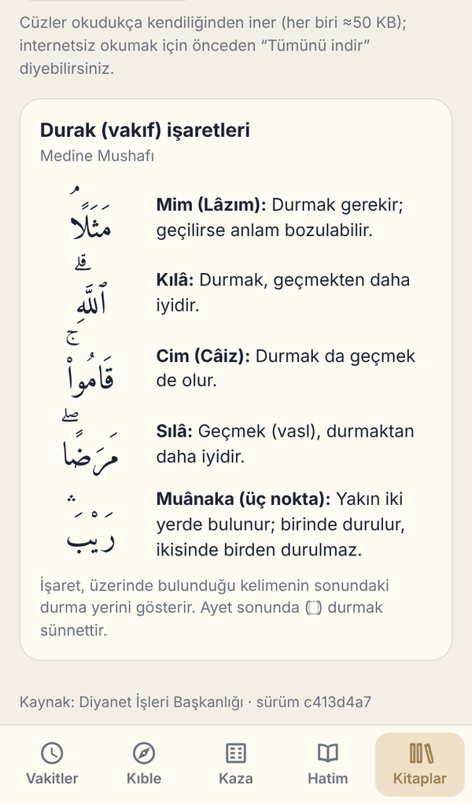<br><sub><b>Durak işaretleri</b> · açıklamalı</sub></td>
<td align="center">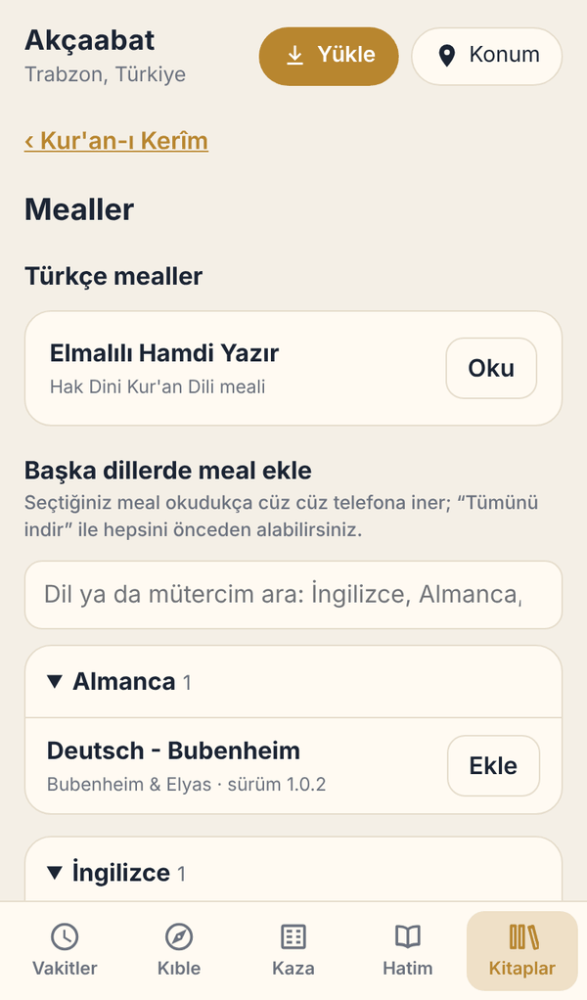<br><sub><b>Başka dillerde meal</b></sub></td>
</tr>
<tr>
<td align="center">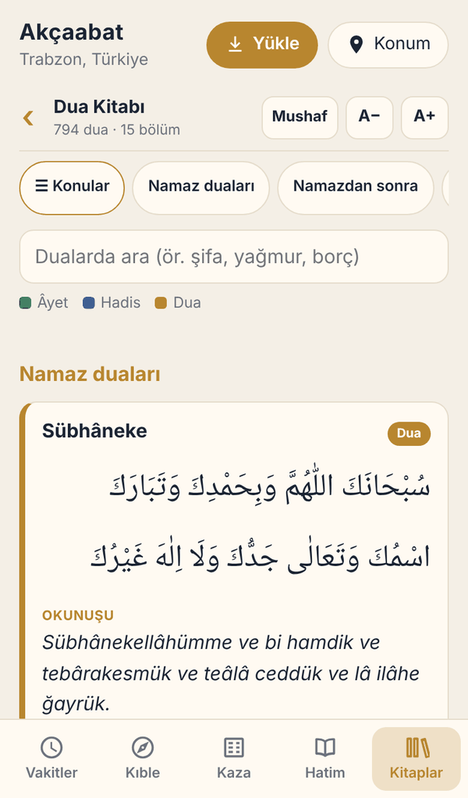<br><sub><b>Dua Kitabı</b> · renkli kaynak</sub></td>
<td align="center">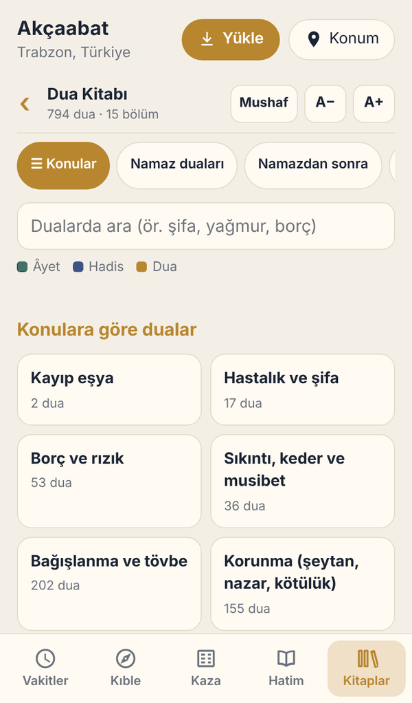<br><sub><b>Konulara göre dualar</b></sub></td>
<td align="center">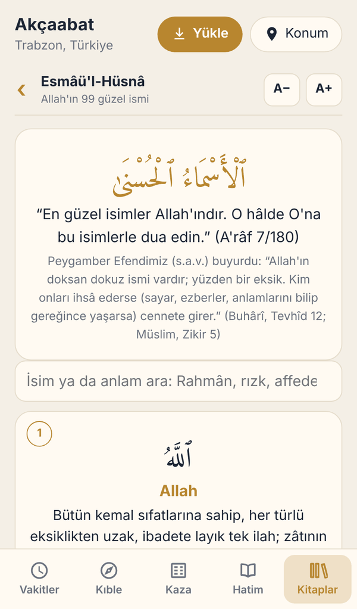<br><sub><b>Esmâü'l-Hüsnâ</b></sub></td>
</tr>
<tr>
<td align="center">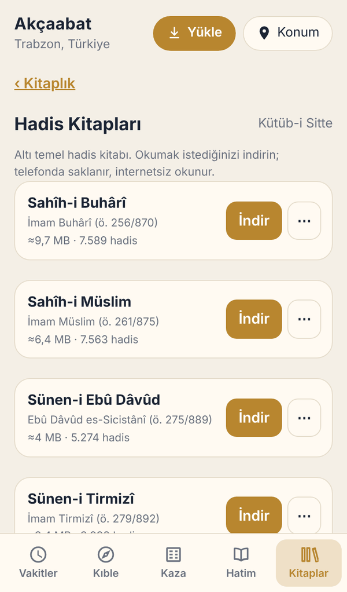<br><sub><b>Hadis Kitapları</b> · Kütüb-i Sitte</sub></td>
<td align="center">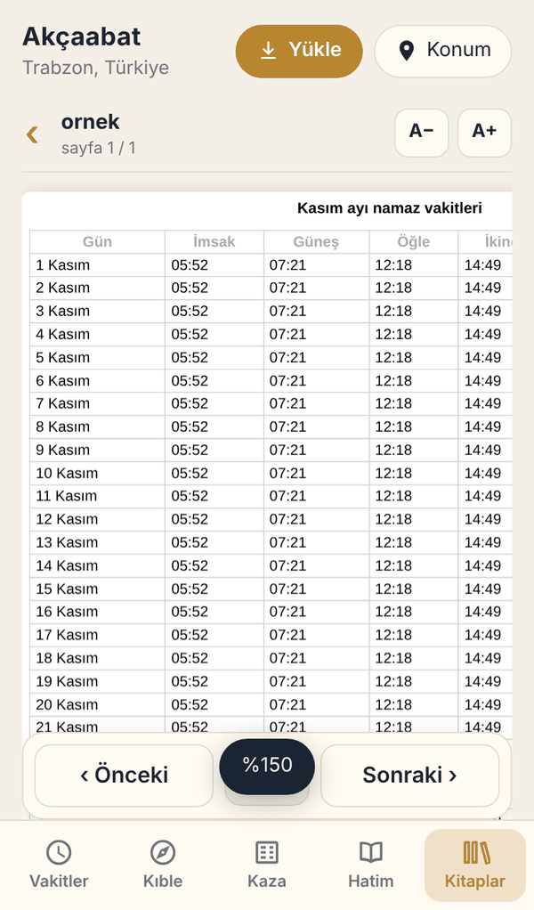<br><sub><b>PDF</b> · düzen bozulmadan yakınlaştırma</sub></td>
<td></td>
</tr>
</table>

---

## Nasıl çalışır?

### Genel mimari

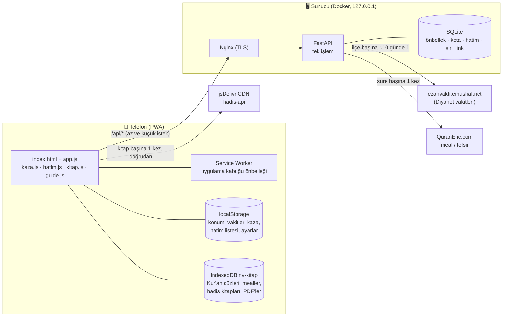

İlke: **İş telefonda yapılır, sunucu yalnızca paylaşılan önbellektir.** Kullanıcı sayısı arttıkça dış kaynaklara giden istek sayısı artmaz.

### Vakitler: en az trafik

| Katman | Kural | Sonuç |
|---|---|---|
| Telefon | Kaynağın tek istekte verdiği ≈30 gün saklanır. Kalan gün 17'nin altına düşünce tamamlanır. | **Yılda ≈26 istek, ≈34 KB** |
| Telefon | Aynı ilçe için aynı gün ikinci istek yapılmaz. Hata olursa 30 dakika sonra tekrar denenir. | Hata döngüsü olmaz |
| Sunucu | Bir ilçenin 20 günlük verisi elde varsa kaynağa gidilmez. | İlçe başına **≈10 günde 1** istek (50 kullanıcı × 365 gün = 18.250 istek → kaynağa 37) |
| Sunucu | Her dış istek gönderilmeden **önce** SQLite'taki günlük sayaca yazılır; limit doluysa istek gitmez. | Kaynak asla yorulmaz |
| Sunucu | Ülke/il/ilçe listeleri 30 gün önbellekte kalır; kaynağa ulaşılamazsa eski liste sunulur. | Kesintiye dayanıklı |
| Sunucu | IP başına dakikada 600 istek sınırı vardır; `TrustedHost` başka alan adını reddeder. | Kötüye kullanıma karşı koruma |

Vakitler telefonda sıkıştırılmış saklanır (≈43 bayt/gün) ve geri sayım cihaz saatine göre yapılır.

### Sürüm ve güncelleme
- Sunucu, `static/` dosyalarının içeriğinden sürümü kendisi hesaplar (ör. `83722c66`). Elle numara artırmaya gerek yoktur.
- Service worker uygulama kabuğunu sürümlü önbellekte tutar. Kitaplık dosyaları (pdf.js, yazı tipleri) ayrı ve kalıcı `nv-assets` önbelleğindedir.
- Güncellemeler **kullanıcı verisine dokunmaz.** Kaza sayıları, hatim listesi, okuma yerleri ve indirilen cüzler korunur. Veri biçimi değişirse eski kayıt, sürüm alanıyla (`v`, `w`) tanınıp internet varken sessizce yenilenir.

### Kıble hesabı
- Büyük daire üzerinde başlangıç açısı hesaplanır: `θ = atan2(sin Δλ·cos φ₂, cos φ₁·sin φ₂ − sin φ₁·cos φ₂·cos Δλ)`. Diyanet'in örneğiyle karşılaştırıldı: Devrekani 164°.
- Manyetik sapma `pygeomag` (WMM2025) ile bulunur. Telefonun pusulası manyetik kuzeyi verdiği için iki açı da gösterilir.
- Titremeyi önlemek için eşik tamponludur: 3°'ye girince yeşil olur, 6°'yi aşınca söner. Pusula zaman bazlı yumuşatılır.

### Hatim: en az sunucu verisi

Link başına `hatim` tablosunda tek satır tutulur:

```text
id      10 karakterlik link kodu
admin   sahibin anahtarının SHA-256 özeti (anahtarın kendisi sunucuda yok)
data    {t: başlık, d: açıklama, dt: dua tarihi, a: oto-yeni,
         r: [{n: no, f: tamamlandı, c: [30 × [durum, ad, cihaz-özeti]]}]}
v, upd  sürüm (ETag/304 için), son erişim
```

- E-posta, telefon numarası, IP ya da konum **tutulmaz**.
- Cüzü yalnızca onu alan telefon (rastgele cihaz kimliğinin 8 karakterlik özetiyle) ve hatmin sahibi değiştirebilir.
- Silme kuralları:
  - 180 gün açılmayan link silinir.
  - Link başına en fazla 10 hatim tutulur.
  - Bir IP günde en fazla 20 hatim oluşturabilir.
- Yönetici linki `/h/<kod>#k=<anahtar>` biçimindedir. Anahtar `#` işaretinden sonra geldiği için tarayıcı onu sunucuya hiç göndermez; sunucu kayıtlarında da görünmez.

### Siri

- Telefon rastgele bir anahtar (`nv_key`) üretir ve **yalnızca ilçe değiştiğinde** `POST /api/link` ile bildirir.
- Kestirme `GET /api/siri?k=<anahtar>&l=tr` adresine sorar ve düz metin cevap alır.
- Sunucuda yalnızca anahtar ile ilçe numarası tutulur; 400 gün kullanılmayan kayıt silinir.

### Kitaplık

| Konu | Mantık |
|---|---|
| **Depolama** | Her şey IndexedDB'de (`nv-kitap`: `quran`, `books`, `files`). Uygulama kalıcı depolama izni ister. |
| **Kur'an** | `static/quran/1..30.json`: sayfa başına `[sure, ayet, metin]`. Okunan cüz iner, sonraki cüz önceden iner. Arama da bu verilerle **telefonda** yapılır. |
| **Türkiye yazımı** | Bilgisayar baskısında metin ekranda Türk mushaflarındaki gibi gösterilir: Medine yazımında boş bırakılan sakin harflere cezm konur (مِنْ رَبِّهِمْ, أُنْزِلَ), kelime başındaki idğam şeddesi, iklâb mimi ve okunmayan harf işaretleri kaldırılır, ٱ → ا, ءَا → اٰ. Yalnız gösterimdir; harfler değişmez (6.236 ayette doğrulandı). “Mushaf” düğmesi aslını gösterir. |
| **Durak işaretleri** | Tanzil metnine, Kral Fehd Kompleksi Hafs metnindeki yerlerine göre eklendi: 4.272 işaret (ۘ ۗ ۚ ۖ ۛ). Kelime iskeletleri karşılaştırılarak her işaretin yeri doğrulandı. Kur'an harflerinde hiçbir değişiklik yapılmadı. |
| **Meal / tefsir** | Elmalılı meali statik dosyadır. QuranEnc mealleri ve tefsiri sunucuda **sure başına bir kez** çekilip saklanır. Kaynakta sürüm değişirse sunucu yeniden çeker. |
| **Hadis kitapları** | Telefon, kitabı CDN'den **doğrudan** indirir. Sunucuda kitap tutulmaz. |
| **Arama** | Metin harf harf sadeleştirilir (hareke silinir, ş→s, ı→i, â→a). Her harfin asıl metindeki yeri de tutulduğu için vurgulama doğru kelimeye denk gelir. |
| **PDF** | pdf.js ile tuvale çizilir. Büyütmede sayfa yüksek çözünürlükte yeniden çizilir; telefonun tuval sınırı (≈16 MP) aşılmaz. Parmakların ortasındaki nokta ekranda sabit kalır. |
| **Dua Kitabı** | Âyetler Kur'an metninden, numarasıyla tek tek seçildi. Hadis duaları Kütüb-i Sitte'den süzüldü (652 hadis, tekrarlar ayıklandı). Konulara anahtar kelimeyle eşlendi. |

---

## Veri kaynakları ve lisanslar

| İçerik | Kaynak | Not |
|---|---|---|
| Namaz vakitleri | [ezanvakti.emushaf.net](https://ezanvakti.emushaf.net) ([açık kaynak](https://github.com/furkantektas/EzanVaktiAPI)) | Diyanet'in tablosunu aynen verir. İsteğe bağlı olarak resmî Diyanet API'si (`PROVIDER=diyanet`) kullanılabilir. |
| Kur'an metni | [Tanzil Projesi](https://tanzil.net), Osmanî | CC BY 3.0. Harfler değiştirilmedi; SHA-256 ile doğrulandı. |
| Durak işaretlerinin yeri | Kral Fehd Kur'an Kompleksi Hafs metni ([fawazahmed0/quran-api](https://github.com/fawazahmed0/quran-api)) | |
| Elmalılı meali | Elmalılı Hamdi Yazır (ö. 1942) | Kamu malı. |
| Muhtasar Tefsir ve diğer dillerde mealler | [QuranEnc.com](https://quranenc.com) | Metin değiştirilmeden, kaynak ve sürümüyle gösterilir. |
| Kütüb-i Sitte | [fawazahmed0/hadith-api](https://github.com/fawazahmed0/hadith-api) | Türkçe tercümeyi hazırlayanın adı kaynakta belirtilmemiştir. |
| Yazı tipleri | Amiri Quran, Noto Naskh Arabic | SIL OFL. |
| PDF okuyucu | [pdf.js](https://mozilla.github.io/pdf.js/) 4.10.38 | Apache 2.0. |

Telifli eserler (Diyanet ilmihali, Risale-i Nur, günümüz tercümeleri vb.) uygulamaya **gömülmez**. Kullanıcı kendi PDF'ini ekleyebilir; dosya yalnızca kendi telefonunda kalır.

---

## Gizlilik

**Tamamen açık kaynak kodlu ve hiçbir veri toplamayan yazılım.**

- Hesap, e-posta ya da telefon numarası istenmez; reklam, çerez ve analitik yoktur.
- Sunucu ziyaret kaydı tutmaz: Nginx'te `access_log off`, uvicorn'da `--no-access-log` açıktır; IP adresleri hiçbir yere yazılmaz (kötüye kullanımı önleyen sayaç yalnızca bellekte, en fazla bir gün durur; diske yazılmaz).
- Konum yalnızca en yakın ilçeyi bulmak için bir kez gönderilir ve **saklanmaz**.
- Kaza kayıtları, okuma yerleri, indirilen kitaplar ve PDF'ler **yalnızca telefonda** tutulur.
- Sunucuda tutulanlar yalnızca şunlardır:
  - paylaşılan vakit önbelleği,
  - hatim linkleri (yalnız yazılan isimler),
  - Siri anahtarı ile ilçe numarası.

---

## Kurulum

### Yerelde denemek (Docker'sız)

```bash
pip install -r requirements.txt
MOCK=1 uvicorn app.main:app --reload     # dış kaynağa gitmez, sahte vakitlerle çalışır
# http://127.0.0.1:8000
```

### Sunucuya (Oracle Linux / RHEL + Nginx + Docker)

Doğrudan GitHub'dan:

```bash
cd ~ && rm -rf pray && git clone --depth 1 https://github.com/purkusur-pixel/pray.git && sudo bash pray/deploy/kurulum.sh
```

ya da zip ile:

```bash
scp ezan-pwa.zip kullanici@SUNUCU:~/
ssh kullanici@SUNUCU
cd ~ && rm -rf ezan-pwa && mkdir ezan-pwa && unzip -oq ezan-pwa.zip -d ezan-pwa && sudo bash ezan-pwa/deploy/kurulum.sh
```

`ALLOWED_HOSTS` ve alan adı ayarları `.env` dosyasındadır (örnek: `.env.example`).

`deploy/kurulum.sh` sırasıyla şunları yapar:

1. Dosyaları kopyalar; `.env` dosyası korunur.
2. Konteyneri yalnızca `127.0.0.1:8070` adresinde başlatır. Port doluysa sıradaki boş portu seçer.
3. SELinux'ta Nginx'in uygulamaya bağlanma iznini açar.
4. Sertifikayı ayarlar: varsa mevcut sertifikayı kullanır, yoksa Let's Encrypt'ten alır.
5. `/etc/nginx/conf.d/namaz.conf` dosyasını ekler. `nginx -t` hata verirse değişikliği geri alır; **sunucudaki diğer sitelere dokunmaz.**
6. Docker volume'undaki veriyi (`namaz-data`) korur. **Güncellemede hiçbir veri kaybolmaz.**

Konteyner salt-okunur dosya sistemiyle, root olmadan ve tüm yetkileri düşürülmüş olarak çalışır.

### Ayarlar (`.env`)

| Değişken | Varsayılan | Açıklama |
|---|---|---|
| `PROVIDER` | `ezanvakti` | `diyanet` için `AWQAT_EMAIL` ve `AWQAT_PASSWORD` da gerekir. |
| `ALLOWED_HOSTS` | — | Sitenin alan adı. Başka Host ile gelen istek `400` alır. |
| `MOCK` | `0` | `1` yapılırsa dış kaynağa gitmez (geliştirme için). |
| `QUOTA_PER_ENDPOINT_PER_DAY` | `10` | Dış kaynağa endpoint başına günlük istek sınırı. |
| `CLIENT_RATE_PER_MIN` | `600` | IP başına dakikalık istek sınırı. |
| `NAMAZ_PORT` | `8070` | Sunucu içi port. |
| `QURANENC_BASE_URL` | `https://quranenc.com/api/v1` | Test için değiştirilebilir. |

### Android uygulaması (APK) yapmak

[PWABuilder](https://www.pwabuilder.com) sitesine adresi girip Android (TWA) paketi oluşturun ya da:

```bash
npx @bubblewrap/cli init --manifest https://ALAN-ADINIZ/manifest.webmanifest
```

---

## API

| Uç | Açıklama |
|---|---|
| `GET /api/countries` · `/api/states/{ülke}` · `/api/cities/{il}` | Konum listeleri (30 gün önbellek) |
| `GET /api/times?state=&city=` | Vakitler (≈30 gün) |
| `GET /api/nearest?lat=&lon=` | En yakın ilçe (konum saklanmaz) |
| `GET /api/qibla?lat=&lon=` | Kıble açısı, manyetik sapma, uzaklık |
| `POST /api/link` · `GET /api/siri?k=&l=tr\|en` | Siri: ilçe bağlama ve düz metin cevap |
| `POST /api/hatim` · `GET /api/hatim/{id}` · `POST /api/hatim/{id}/cuz` … | Hatim oluşturma, okuma, cüz işlemleri, yönetim |
| `GET /api/tefsir/{cüz}` | Muhtasar tefsir (QuranEnc, sunucu önbelleği) |
| `GET /api/qe/list` · `GET /api/qe/{anahtar}/{cüz}` | Başka dillerde mealler |
| `GET /api/status` | Sürüm ve bugünkü dış istek sayısı |

---

## Proje yapısı

```text
app/
  main.py         FastAPI: vakit, konum, kıble, Siri uçları; PWA dosyalarının servisi; sürüm hesabı
  sources.py      vakit kaynakları: ezanvakti (varsayılan), diyanet, mock
  store.py        SQLite: önbellek, kota sayacı, siri_link
  hatim.py        hatim dağıtma (link başına tek satır)
  quranenc.py     QuranEnc meal/tefsir önbelleği (sure başına bir kez, sürüm takibi)
  config.py       ayarlar (.env)
static/
  index.html  app.js  style.css  sw.js  manifest.webmanifest
  guide.js        Siri / Google kılavuzu (TR/EN, SVG görseller)
  kaza.js         kaza takibi
  hatim.js        hatim dağıtma arayüzü
  kitap.js        kitaplık: Kur'an, meal, arama, dua, esmâ, hadis, PDF
  quran/          30 cüz + meta.json (sayfa, cüz, sure bilgisi)
  meal/           Elmalılı meali (cüz cüz)
  books/          dua.json, dua-hadis.json, esma.json, hadis.json
  fonts/  vendor/pdfjs-4.10.38/  icons/
deploy/
  kurulum.sh  nginx-namaz.conf
docs/screenshots/ README görselleri
Dockerfile  docker-compose.yml  docker-entrypoint.sh
```
